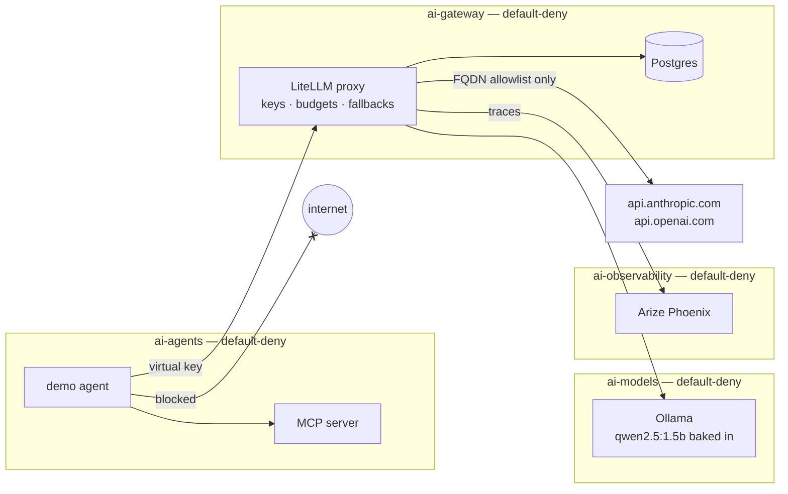
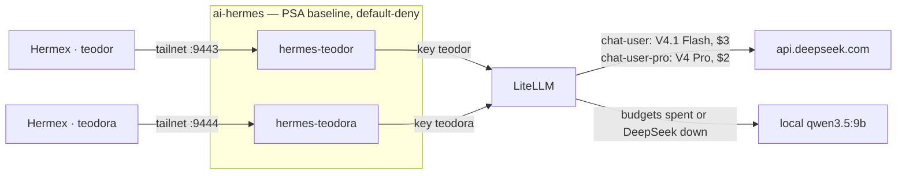

# secure-ai-gateway

> A **governed, observable and isolated LLM platform** on top of the
> [secure-k8s-lab](https://github.com/teodorio95-portofolio/secure-k8s-lab)
> cluster: every model call goes through one gateway that knows who is calling,
> what it costs and where it is allowed to go.

## The story this repo tells

> "Agents in this cluster can't reach the internet. Every LLM call goes through a
> gateway that enforces per-team keys, budgets and rate limits, is traced end to
> end, and a prompt-injected agent can't pivot anywhere."

## Status

Built phase by phase; each phase is reviewed before the next one starts.

| Phase | Scope | State |
|-------|-------|-------|
| 0 | Exploration, versions, plan | ✅ |
| 1 | Repo skeleton + GitOps wiring (namespaces + their cages) | ✅ |
| 2 | Secrets (Sealed Secrets, BYO sealing key) | ✅ |
| 3 | LiteLLM gateway + Postgres + bootstrap Job | ✅ |
| 4 | Tracing (Arize Phoenix) + Prometheus metrics | ✅ |
| 5 | Demo agent + MCP server | ✅ |
| 6 | Cilium FQDN egress + AI-specific Kyverno policies | ✅ |
| 7 | CI + docs | ✅ |

## Architecture



## Wiring it into secure-k8s-lab

This repo is pulled into the lab exactly like `runtime-security`: one
`Application` in secure-k8s-lab points at [gitops/](gitops/), which holds this
repo's own child Applications (cross-repo app-of-apps).

```bash
make wire-lab            # copies bootstrap/secure-k8s-lab/secure-ai-gateway.yaml
                         # into ../secure-k8s-lab/apps/argocd-apps/
# commit + push in secure-k8s-lab — the root app syncs it
make apps-status         # sync/health of the AI Applications
make verify-namespaces   # every ai-* namespace: PSA restricted + default-deny
```

## Quick start (from a clean cluster)

Prerequisites: secure-k8s-lab's tooling (Colima/Docker, k3d, kubectl, helm) plus
`kubeseal` 0.40 and `openssl`. Give Colima **6 CPU / 10 GiB** — the base lab plus
LiteLLM, Phoenix and a 1.5B model need it.

```bash
# in secure-k8s-lab (already wired to this repo)
make up

# here
make build-images          # Ollama+model, MCP server, agent → k3d (≈3 GB, once)
make sealing-key-install   # your BYO sealing key → the SealedSecrets in git decrypt
make apps-status           # wait for everything Synced/Healthy (~5 min first time)

make gateway-test          # auth · team scope · provider fallback · budget
make agent-ask Q="What is the status of ticket TCK-1003?"
make verify-ai-netpol      # 7 network paths, each BLOCKED or REACHABLE as designed
make traces-ui             # http://localhost:6006 — every call above, traced
```

A fork runs `make sealing-key && make seal-secrets` once first and commits the
result: the ciphertext in this repo only opens with the author's key.

## On a real box (homelab)

The same stack also runs 24/7 on a headless mini PC (Ryzen 5 7640HS, 32 GB,
Debian 13 + k3s, managed over Tailscale) — see secure-k8s-lab's
[homelab runbook](https://github.com/teodorio95-portofolio/secure-k8s-lab/blob/homelab/homelab/README.md).
Three Applications change and one is added, in [gitops-homelab/](gitops-homelab/):
a bigger local model (`qwen3.5:9b` on the Radeon 760M iGPU through Vulkan,
requested from the cluster's device plugin as `squat.ai/dri`, still PSA
`restricted`; [values-homelab.yaml](charts/ai-models/values-homelab.yaml)), the
gateway's `local` alias pointing at it plus the family's DeepSeek aliases
([litellm-homelab.yaml](values/litellm-homelab.yaml)), the gateway zone
([values-homelab.yaml](charts/ai-gateway/values-homelab.yaml)) and the family
chat zone below. Everything else syncs from `gitops/` unchanged.

```bash
# after `make homelab-up` in secure-k8s-lab
export KUBECONFIG=~/.kube/homelab.yaml
make sealing-key-install   # same BYO key → the same SealedSecrets decrypt
make homelab-images        # built ON the mini PC (amd64), imported into its k3s
make apps-status
```

On a real Linux node Falco captures syscalls, so the agent rules in
[docs/falco/](docs/falco/ai-agent-rules.yaml) actually fire there.

### Family chat: Hermes + the Hermex iPhone app

Two people, two [Hermes Agent](https://github.com/NousResearch/hermes-agent)
instances ([charts/ai-hermes](charts/ai-hermes/)), each with its own history
volume, dashboard login and LiteLLM virtual key. The
[Hermex](https://apps.apple.com/app/id6767006319) app on each iPhone talks to
its own instance over Tailscale. The ChatGPT / Claude subscriptions stay in
their official apps: this path is pay-per-use through the gateway.



| | |
|---|---|
| Models | Per person `chat-<user>` = `deepseek/deepseek-flash` (V4.1 Flash, the default, thinking off for fast replies) and `chat-<user>-pro` = `deepseek/deepseek-v4-pro` (thinking on). In Hermes: `/model pro`, `/model flash`, or `/model pro --once` for one question (`scripts/hermes-configure.sh` defines the aliases) |
| Budget | $5 a person a month, on the deployments (`30d`): $3 flash, $2 pro, priced in the config at DeepSeek's peak rates (not LiteLLM's bundled map), so the count tracks the real bill and errs on the safe side off-peak. A spent alias is dropped by the router: pro falls back to flash, flash to `local`; the other person is untouched. A key or team budget would refuse the request instead, so the per-key `max_budget` (15) is only a runaway ceiling. `make check-budget-fallback` (and CI) proves it offline against the pinned LiteLLM |
| Budget caveat | Deployment spend is counted in the proxy's memory (no Redis here): a proxy restart restarts the month's count. The DeepSeek account's prepaid balance is the hard ceiling |
| Isolation | Egress only to LiteLLM and DNS (web and browser tools stay dark), ingress only from the host, where `tailscale serve` proxies the tailnet to a fixed ClusterIP; nothing on the LAN. Kyverno lets each pod read only `hermes-<its ai.user>` |
| Why `baseline` | The official image starts as root under s6-overlay (`/init` chowns the data volume), then runs Hermes as uid 10000. The pod drops every capability except the seven that needs, with no privilege escalation |
| Keys | The virtual key is `OPENAI_API_KEY` in the pod, a name Hermes keeps out of its tools' subprocesses; `config.yaml` holds only the `${OPENAI_API_KEY}` template |

```bash
WITH_PROVIDERS=1 DEEPSEEK_API_KEY=... WITH_HERMES=1 make seal-secrets   # commit secrets/sealed/
make hermes-configure      # model.provider custom → LiteLLM, model.default chat-<user>
make hermes-serve          # tailscale serve --https=9443 / 9444 on the box
make hermes-status
HERMES=1 make verify-ai-netpol
```

In Hermex: add a server `https://homelab.<tailnet>.ts.net:9443` (teodora: `:9444`)
and sign in with **Username & password** from
`~/.config/secure-ai-gateway/hermes-<user>.env`. The second person needs the
tailnet on her phone (invite her, or share the `homelab` node with her); a
Tailscale ACL can limit her to port 9444.

#### Try it on the Mac first

Until the box arrives, [mac/compose.yaml](mac/compose.yaml) runs the same family
chat in Colima's Docker, outside the k3d lab: Postgres, LiteLLM and both Hermes
instances. LiteLLM's aliases, budgets and key bootstrap are rendered from the
same `values/litellm*.yaml` ([mac/render.py](mac/render.py)). The Mac has no
local model, so once both of a person's budgets are spent the reply is an error
there instead of `local` (pro still falls back to flash).

The cage matches the cluster's. Hermes sits on a Docker network with no route
out and reaches only LiteLLM; an nginx TCP proxy publishes the two dashboards on
`127.0.0.1:19119` / `:19120`, and `tailscale serve` carries them to the tailnet.

```bash
make mac-secrets     # mac/.env (0600, git-ignored); prompts for the DeepSeek key
make mac-up          # first start pulls ~1 GB per Hermes image
make mac-configure   # each Hermes → LiteLLM, model chat-<user>
make mac-serve       # https://<mac>.<tailnet>.ts.net:9443 (teodor), :9444 (teodora)
make mac-test        # each key reaches only its own aliases (flash + pro, one real call each)
make mac-logins      # what to type into Hermex
make mac-down        # WIPE=1 also deletes chat history, keys and spend
```

Needs Colima running with room for the stack (2 GiB per Hermes, ~1 GiB
LiteLLM): next to the k3d lab's 10 GiB, give Colima more memory or stop the lab.
`tailscale serve` needs HTTPS certificates enabled for the tailnet. The admin UI
is at <http://127.0.0.1:14000/ui> (master key in `mac/.env`). Chat history stays
in the `family-chat_hermes-*` volumes; it does not move to the homelab.

## Secrets

Secrets are [Sealed Secrets](https://github.com/bitnami/sealed-secrets)
sealed with a **bring-your-own key**: the private key lives in
`~/.config/secure-ai-gateway/`, the public cert and the ciphertext live in git,
and every fresh cluster gets the same key — so what's committed always decrypts.
The lab runs with **no paid API keys**; they are an opt-in extra.

```bash
make sealing-key           # once: key pair + secrets/sealing-cert.pem
make seal-secrets          # generate + seal; prints file names, never values
make sealing-key-install   # per cluster, right after `make up` in secure-k8s-lab
make verify-secrets        # every SealedSecret → UNSEALED / MISSING
```

Details, the secret inventory and rotation: [secrets/README.md](secrets/README.md).

## The gateway

[LiteLLM](https://github.com/BerriAI/litellm) is the only door to a model. Clients
call aliases — `default` (Anthropic), `cheap` (OpenAI), `local` (Ollama in the
cluster) — with a virtual key that belongs to a team with a budget and rate
limits. Paid aliases fall back to the next provider and finally to `local`, so
the lab works with **no paid API key at all**.

```bash
make build-images     # Ollama + qwen2.5:1.5b baked in → imported into k3d
make gateway-test     # auth, team scope, provider fallback, budget → PASS/FAIL
make gateway-ui       # http://localhost:4000/ui (admin: the master key)
```

Why it's built this way: [docs/architecture.md](docs/architecture.md#phase-3-the-gateway).

## Agents, tools and traces

The demo agent (`ai-agents`) is an OpenAI-compatible client with exactly two
things it can reach: the LiteLLM port, with **its own virtual key** (team
`team-support`, $0.50, `cheap` + `local` only), and an **MCP server** with two
read-only tools (`lookup_ticket`, `get_runbook`). No provider key, no
ServiceAccount token, no internet.

Every call is traced to **Arize Phoenix** (team, key alias, model, tokens, cost,
latency) and counted on LiteLLM's Prometheus `/metrics`.

## What an attacker can and can't do

Assume the worst: a prompt injection in a ticket gets the agent to run whatever
the attacker wants.

| The attacker tries to… | What happens |
|------------------------|--------------|
| exfiltrate data to the internet | **Blocked** — agent egress is LiteLLM + MCP + DNS only (`verify-ai-netpol`) |
| steal a provider API key | **Nothing to steal** — only the gateway holds them; Kyverno flags any agent pod that references another secret |
| call the Kubernetes API | **No token, no route** — `automountServiceAccountToken: false` (Kyverno-checked) and the API server is outside the cage |
| call the model directly, skipping the gateway | **Blocked** — Ollama accepts the LiteLLM pods only |
| burn money with the agent's key | **Capped** — the key's own budget, then the team's; RPM/TPM limits; every call traced |
| use a paid model the team isn't allowed | **403** — keys are scoped to aliases (`gateway-test`) |
| pivot through the gateway to any host | **Blocked** — LiteLLM's egress is an FQDN allowlist (`api.anthropic.com`, `api.openai.com`) |
| drop a shell in the agent | Contained by all of the above; Falco rules in [docs/falco/](docs/falco/ai-agent-rules.yaml) alert on it (see ⚠️) |

What it **can** do: spend the agent key's remaining budget on the models that
key allows, and read the two fake tools' data — by design, that's the agent's job.

## Platform concerns this covers

| Concern | How |
|---------|-----|
| Cost governance | per-team and per-key budgets, internal chargeback rate for the local model |
| Abuse / noisy neighbours | RPM/TPM limits per team and per key |
| Provider failover | `default` → `cheap` → `local` router fallbacks |
| Least privilege | virtual keys scoped to aliases; agents hold one key, no SA token |
| Network isolation | four default-deny zones, CiliumNetworkPolicies, FQDN egress allowlist |
| Audit / observability | Phoenix traces per call, Prometheus metrics, LiteLLM spend logs |
| Secrets | Sealed Secrets with a BYO key; nothing in clear in git |
| Supply chain | images pinned by digest, hash-checked Python deps, registry allowlist (Kyverno), Trivy |
| Policy as code | Kyverno guardrails with `kyverno test` in CI |

## Repository layout

```text
secure-ai-gateway/
├── Makefile                     # lifecycle + verification targets
├── bootstrap/
│   └── secure-k8s-lab/
│       ├── secure-ai-gateway.yaml          # the one Application added to secure-k8s-lab
│       └── secure-ai-gateway-homelab.yaml  # its homelab variant (gitops/ + gitops-homelab/)
├── gitops-homelab/              # homelab: ai-models, ai-gateway, litellm overrides + ai-hermes
├── gitops/                      # child ArgoCD Applications
│   ├── sealed-secrets.yaml      # controller in kube-system (wave -1)
│   ├── ai-gateway.yaml          # one per zone (wave 0)
│   ├── ai-models.yaml
│   ├── ai-observability.yaml
│   ├── ai-agents.yaml
│   ├── ai-policies.yaml         # AI Kyverno guardrails (wave -1)
│   ├── ai-secrets.yaml          # syncs secrets/sealed/
│   └── litellm.yaml             # the gateway (wave 1)
├── charts/                      # our own minimal charts: each zone carries its cage
│   ├── ai-gateway/
│   ├── ai-models/
│   ├── ai-observability/
│   ├── ai-agents/
│   └── ai-hermes/               # homelab: one Hermes Agent per family member
├── values/                      # our values for upstream charts (Sealed Secrets, LiteLLM, Phoenix)
├── images/                      # Dockerfiles for the MCP server, agent, Ollama+model
├── mac/                         # family chat on the Mac (Docker Compose) until the homelab box
├── secrets/                     # public sealing cert + SealedSecrets (ciphertext only)
├── policies/kyverno/            # AI-specific guardrails (Audit) + kyverno tests
├── scripts/                     # lint.sh (same gate locally and in CI), seal-secrets.sh,
│                                # gateway-test.sh, verify-ai-netpol.sh, check-budget-fallback.py
├── .github/workflows/           # CI: helm lint + kubeconform, gitleaks, kyverno test, budget fallback, Trivy, markdownlint
└── docs/
    ├── architecture.md          # design decisions and trade-offs
    └── falco/                   # AI-agent rules for runtime-security's Falco
```

## ⚠️ Notes

- **Laptop-sized.** The local model is `qwen2.5:1.5b` on CPU: answers take
  seconds, and it often *describes* a tool call instead of making one, so the
  agent looks tickets up through MCP before asking it. A paid model (opt-in key)
  uses the tools directly.
- **Falco on Colima + k3d** loads the rules but captures no syscalls (see
  runtime-security); the agent rules are for a real Linux node.
- Kyverno runs in **Audit**, like the rest of secure-k8s-lab: violations show up
  in `kubectl get policyreport -A`, they don't block admission.
- Phoenix's UI is only reachable through `make traces-ui`; the initial admin
  password is random and sealed, not `admin`.
