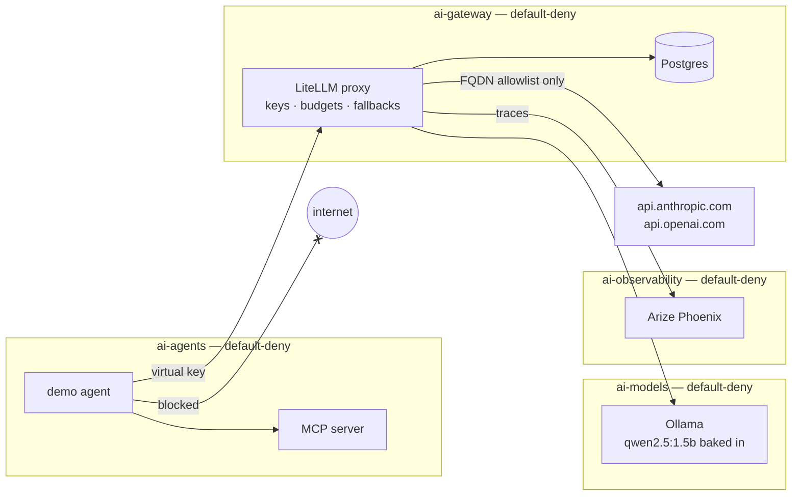

# secure-ai-gateway

> A **governed, observable and isolated LLM platform** on top of the
> [secure-k8s-lab](https://github.com/teodorio95-portofolio/secure-k8s-lab)
> cluster: every model call goes through one gateway that knows who is calling,
> what it costs and where it is allowed to go.

## The story this repo tells

> "Agents in this cluster can't reach the internet. Every LLM call goes through a
> gateway that enforces per-team keys, budgets and rate limits, is traced end to
> end, and a prompt-injected agent can't pivot anywhere."

## Status

Built phase by phase; each phase is reviewed before the next one starts.

| Phase | Scope | State |
|-------|-------|-------|
| 0 | Exploration, versions, plan | ✅ |
| 1 | Repo skeleton + GitOps wiring (namespaces + their cages) | ✅ |
| 2 | Secrets (Sealed Secrets, BYO sealing key) | ⏳ |
| 3 | LiteLLM gateway + Postgres + bootstrap Job | ⏳ |
| 4 | Tracing (Arize Phoenix) + Prometheus metrics | ⏳ |
| 5 | Demo agent + MCP server | ⏳ |
| 6 | Cilium FQDN egress + AI-specific Kyverno policies | ⏳ |
| 7 | CI + docs | ⏳ |

## Target architecture



## Wiring it into secure-k8s-lab

This repo is pulled into the lab exactly like `runtime-security`: one
`Application` in secure-k8s-lab points at [gitops/](gitops/), which holds this
repo's own child Applications (cross-repo app-of-apps).

```bash
make wire-lab            # copies bootstrap/secure-k8s-lab/secure-ai-gateway.yaml
                         # into ../secure-k8s-lab/apps/argocd-apps/
# commit + push in secure-k8s-lab — the root app syncs it
make apps-status         # sync/health of the AI Applications
make verify-namespaces   # every ai-* namespace: PSA restricted + default-deny
```

## Repository layout

```text
secure-ai-gateway/
├── Makefile                     # lifecycle + verification targets
├── bootstrap/
│   └── secure-k8s-lab/
│       └── secure-ai-gateway.yaml  # the one Application added to secure-k8s-lab
├── gitops/                      # child ArgoCD Applications (one per zone)
│   ├── ai-gateway.yaml
│   ├── ai-models.yaml
│   ├── ai-observability.yaml
│   └── ai-agents.yaml
├── charts/                      # our own minimal charts: each zone carries its cage
│   ├── ai-gateway/
│   ├── ai-models/
│   ├── ai-observability/
│   └── ai-agents/
├── values/                      # values for upstream charts (LiteLLM, Phoenix)
├── images/                      # Dockerfiles for the MCP server, agent, Ollama+model
├── secrets/                     # SealedSecrets (ciphertext only)
├── policies/kyverno/            # AI-specific guardrails (Audit) + kyverno tests
├── scripts/                     # lint.sh (same gate locally and in CI)
├── .github/workflows/           # CI + mirror to GitLab
└── docs/
    └── architecture.md          # design decisions and trade-offs
```
