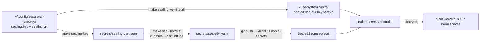

# Secrets

> Everything in this directory is safe to publish: `sealing-cert.pem` is a
> public certificate and `sealed/` holds only ciphertext that the in-cluster
> Sealed Secrets controller can open — with a private key that never touches git.

## How it fits together



| What | Where | In git? |
|------|-------|---------|
| Sealing private key | `~/.config/secure-ai-gateway/sealing.key` (mode 600) | **never** (`*.key` is git-ignored) |
| Sealing certificate | `secrets/sealing-cert.pem` | yes — lets anyone seal offline |
| SealedSecrets | `secrets/sealed/*.yaml` | yes — ciphertext, strict scope |
| Decrypted Secrets | only inside the cluster | no |

## The secrets

| SealedSecret | Namespace | Keys | Used by |
|--------------|-----------|------|---------|
| `litellm-masterkey` | ai-gateway | `masterkey` | LiteLLM admin API (phase 3) |
| `litellm-postgres` | ai-gateway | `username`, `password` | our Postgres + LiteLLM `db.useExisting` |
| `agent-virtual-key` | ai-gateway **and** ai-agents | `api-key` | bootstrap Job registers it; the demo agent presents it |
| `phoenix-secret` | ai-observability | `PHOENIX_SECRET`, `PHOENIX_ADMIN_SECRET`, … | Arize Phoenix auth (phase 4) |
| `llm-provider-keys` | ai-gateway | `ANTHROPIC_API_KEY` / `OPENAI_API_KEY` | **optional**; without it paid aliases fall back to the local model |

The agent key is one value sealed twice, once per namespace, so neither side
needs RBAC to read the other namespace's Secrets.

## Flows

**First time (or a fork):**

```bash
make sealing-key        # key pair in ~/.config/secure-ai-gateway, cert → secrets/sealing-cert.pem
make seal-secrets       # writes secrets/sealed/*.yaml (prints file names, never values)
git add secrets/ && git commit && git push
```

**Every fresh cluster** (after `make up` in secure-k8s-lab):

```bash
make sealing-key-install   # the controller uses *your* key, so what's in git decrypts
make verify-secrets        # every SealedSecret → UNSEALED / MISSING
```

Run it before ArgoCD starts the controller and the controller never generates a
key of its own; run it after and it restarts the controller to load the key.

**Optional paid providers** (opt-in, so a key that just happens to be exported
in your shell is never sealed by accident):

```bash
export ANTHROPIC_API_KEY=...   # and/or OPENAI_API_KEY
WITH_PROVIDERS=1 make seal-secrets
```

**Rotation:** `make seal-secrets` keeps files that already exist, because a new
Postgres password would no longer match the database on the PVC. `ROTATE=1 make
seal-secrets` re-seals everything — delete the `ai-gateway` PVCs alongside.

## ⚠️ Notes

- **Forks must re-seal.** The ciphertext here only opens with the author's
  private key. Run `make sealing-key` (a new pair) and `make seal-secrets`.
- **Lose the key, lose the secrets.** Back up `~/.config/secure-ai-gateway/`
  somewhere safe (a password manager); without it, re-seal from scratch.
- Key rotation by the controller is turned off (`keyrenewperiod: "0"`): the BYO
  key is the only sealing key, which keeps the committed cert valid.
- gitleaks flags SealedSecret ciphertext as `generic-api-key` (high entropy);
  [.gitleaks.toml](../.gitleaks.toml) allows lines shaped like that ciphertext
  only, so a plaintext Secret placed here is still reported.
